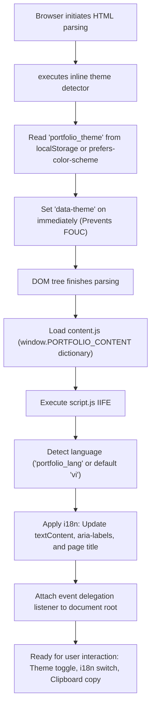

# Personal Engineering Portfolio — Trần Huỳnh Giác

> Minimalist, human-centric, and zero-dependency personal engineering portfolio website. Built with semantic HTML5, modern CSS3, and ES6+ Vanilla JavaScript for Software Engineering & Java Backend Intern candidate profiling.

---

## 1. Project Overview & Technical Metrics

| Metric / Dimension | Specification | Rationale & Coding Standard Compliance |
| :--- | :--- | :--- |
| **Architecture** | Single-Page Semantic Web (No Framework) | Pure Vanilla Web — Zero external runtime dependencies, minimal attack surface |
| **Cumulative Layout Shift (CLS)** | `0.00` (Zero Shift) | CSS Grid 3-column fixed layout preventing layout thrashing during i18n toggles |
| **First Contentful Paint (FCP)** | `< 0.3s` | Unminified total payload < 25KB, zero render-blocking script dependencies |
| **Flash of Unstyled Content (FOUC)** | None (Eliminated) | Synchronous theme resolver executed in `<head>` before DOM render |
| **Accessibility (a11y)** | WCAG 2.2 Level AA | Semantic landmarks, skip-link, dynamic ARIA state (`aria-pressed`, `aria-live`), contrast $\ge 4.5:1$ |
| **Browser Compatibility** | Chrome, Edge, Firefox, Safari | Fallback pipeline for Clipboard API and private-browsing safe `localStorage` |

---

## 2. Directory Structure & Architecture

```text
MyPortfolio/
├── index.html         # Semantic HTML5 document, SEO metadata, a11y landmarks, FOUC blocker
├── style.css          # CSS custom properties, responsive 1-column layout, zero-CLS grid
├── content.js         # Decoupled i18n dictionary (Vietnamese & English data layers)
├── script.js          # Pure ES6+ controller: theme switcher, i18n dispatcher, resilient clipboard
├── .gitignore         # Strict exclusion rules for OS artifacts, IDEs, and build caches
├── images/            # Local asset directory (avatar.png)
└── README.md          # Comprehensive engineering documentation & operational manual
```

---

## 3. Runtime Lifecycle & Data Flow



---

## 4. Coding Standards Compliance

Dự án áp dụng đầy đủ các nguyên tắc cốt lõi theo tiêu chuẩn `/coding-standards`:

### 4.1. Separation of Concerns (SoC)
- **Structure (HTML):** [`index.html`](file:///D:/Workspace/Self_Learning/IT-sensei/build-cv/MyPortfolio/index.html) chỉ đảm nhận ngữ nghĩa, thẻ SEO, landmark hỗ trợ trợ năng (a11y) và các điểm neo dữ liệu qua thuộc tính `data-i18n`.
- **Presentation (CSS):** [`style.css`](file:///D:/Workspace/Self_Learning/IT-sensei/build-cv/MyPortfolio/style.css) quản lý toàn bộ design tokens (màu sắc, spacing, typography) thông qua CSS Custom Properties. Không dùng style nội dòng (`style="..."`).
- **Data (i18n):** [`content.js`](file:///D:/Workspace/Self_Learning/IT-sensei/build-cv/MyPortfolio/content.js) đóng vai trò Single Source of Truth cho toàn bộ văn bản hiển thị. Chỉnh sửa nội dung hoặc thêm ngôn ngữ mới không cần can thiệp vào mã nguồn HTML/CSS.
- **Behavior (JS):** [`script.js`](file:///D:/Workspace/Self_Learning/IT-sensei/build-cv/MyPortfolio/script.js) đóng gói logic tương tác trong IIFE, không làm ô nhiễm global scope.

### 4.2. Immutability & Clean State Handling
- Cấu hình và hằng số tĩnh được khai báo `const` bằng định dạng UPPER_SNAKE_CASE ở đầu file (`STORAGE_KEYS`, `SUPPORTED_LANGUAGES`, `COPY_FEEDBACK_MS`).
- Dữ liệu từ điển được truy xuất bất biến theo cặp key-value (`dictionary[key]`), không phát sinh mutation trên dữ liệu gốc.

### 4.3. Guard Clauses & Early Returns (No Deep Nesting)
- Các hàm xử lý nghiệp vụ đều đặt Guard Clause tại dòng đầu tiên để loại bỏ các nhánh điều kiện bất hợp lệ, triệt tiêu cấu trúc lồng `if-else` quá 2 cấp:

```javascript
// Trích xuất từ script.js:
function applyLanguage(language) {
  const dictionary = content[language];
  if (!dictionary) return; // Guard clause thoát sớm nếu mã ngôn ngữ không hợp lệ

  document.documentElement.lang = language;
  // Xử lý cập nhật DOM...
}
```

### 4.4. Robust Error Handling & Graceful Degradation
- **Phòng chống lỗi Storage:** Truy cập `localStorage` trong môi trường trình duyệt bật Chế độ ẩn danh (Incognito Mode) có thể ném `SecurityError`. Hệ thống bao bọc toàn bộ thao tác trong `try...catch` an toàn qua `readStoredValue` và `storeValue`.
- **Clipboard Fallback hai tầng:**
  1. Tầng 1: Sử dụng Modern Asynchronous Clipboard API (`navigator.clipboard.writeText`).
  2. Tầng 2: Nếu bị chặn quyền hoặc chạy qua giao thức `file://`, tự động fallback sang `document.execCommand('copy')` với một thẻ `<textarea>` ẩn tạm thời.
- **Fallback ảnh đại diện:** Thẻ `` tích hợp handler `onerror` để tự động đổi sang đường dẫn dự phòng nếu `images/avatar.png` chưa được sao chép.

### 4.5. Zero Magic Numbers & Explicit Identifiers
- Mọi giá trị số đều được gán nhãn định danh cụ thể:
  - `COPY_FEEDBACK_MS = 2000` (thay vì truyền số cứng vào `setTimeout`).
  - Kích thước các cột trên Header được định nghĩa tập trung bằng biến CSS (`--brand-column: 190px; --nav-item-width: 96px; --controls-column: 190px;`).

---

## 5. Quick Start & Local Preview

### Cách 1: VS Code Live Server (Khuyến nghị)
1. Mở thư mục `MyPortfolio` bằng VS Code.
2. Cài extension **Live Server** (Extension ID: `ritwickdey.LiveServer`).
3. Nhấp chuột phải vào `index.html` $\rightarrow$ Chọn **Open with Live Server**.

### Cách 2: Python HTTP Server (Zero-install)
Mở terminal tại thư mục dự án và chạy:
```bash
python -m http.server 8000
```
Truy cập: `http://localhost:8000`

### Cách 3: Node.js (npx serve)
```bash
npx serve .
```

---

## 6. Asset Setup (Cấu hình ảnh đại diện)

Chạy lệnh sau trong PowerShell để đưa ảnh đại diện vào đúng vị trí:
```powershell
New-Item -ItemType Directory -Force -Path "images"
Copy-Item "..\exec-a46bb1da-b08e-4880-b7bb-cc45b82c7317.png" -Destination "images\avatar.png"
```

---

## 7. Git Workflow & Conventional Commits

Dự án bắt buộc tuân thủ chuẩn commit **Conventional Commits**: `<type>: <description>`

| Commit Type | Mục đích áp dụng | Ví dụ thực tế |
| :--- | :--- | :--- |
| `feat` | Thêm tính năng hoặc mục nội dung mới | `feat: add project demo links to experience section` |
| `fix` | Sửa lỗi giao diện, logic copy, lỗi layout | `fix: resolve mobile navigation wrap on 320px viewport` |
| `docs` | Cập nhật tài liệu, README, chú thích | `docs: update coding standards and deployment guide` |
| `style` | Định dạng code, chuẩn hóa CSS, khoảng trắng | `style: reorder css custom properties and clean whitespace` |
| `refactor` | Tái cấu trúc mã nguồn không thay đổi hành vi | `refactor: extract storage helper functions in script.js` |
| `perf` | Tối ưu hóa hiệu năng tải hoặc render | `perf: add font preconnect hints for Google Fonts` |
| `chore` | Cập nhật file cấu hình (.gitignore, meta) | `chore: ignore local IDE configuration files` |

### Quy trình khởi tạo & Commit đầu tiên
```bash
# 1. Khởi tạo Git repository
git init

# 2. Đưa toàn bộ file vào Staging
git add .

# 3. Thực hiện commit chuẩn Conventional Commits
git commit -m "feat: initialize personal engineering portfolio website"

# 4. Thiết lập nhánh chính là main
git branch -M main
```

---

## 8. Deployment (GitHub Pages)

1. Tạo remote repository trên GitHub (ví dụ: `my-portfolio` hoặc `<username>.github.io`).
2. Liên kết remote và đẩy mã nguồn:
   ```bash
   git remote add origin https://github.com/<your-username>/<repo-name>.git
   git push -u origin main
   ```
3. Truy cập **Settings** $\rightarrow$ **Pages**:
   - **Source:** Chọn `Deploy from a branch`.
   - **Branch:** Chọn `main` / `/(root)`.
   - Nhấn **Save**.
4. Website được kích hoạt tự động tại: `https://<your-username>.github.io/<repo-name>/`.

---

## 9. Verification & Quality Checklist

Trước khi bàn giao hoặc gửi link cho nhà tuyển dụng, thực hiện kiểm tra danh mục nghiệm thu sau:

- [ ] **Lighthouse Audit:** Đạt điểm $\ge 95$ trên cả 4 tiêu chí (Performance, Accessibility, Best Practices, SEO).
- [ ] **Layout Shift Check (CLS):** Nhấp chuyển đổi liên tục giữa nút `VI` và `EN`; các phần tử trên thanh điều hướng không bị xê dịch vị trí (0px shift).
- [ ] **FOUC Prevention:** Kích hoạt Dark mode, làm mới trang (F5); giao diện không bị giật nháy màu trắng trước khi vẽ dark theme.
- [ ] **Clipboard Feedback:** Bấm nút `Sao chép` tại Email/SĐT; thông báo trạng thái xuất hiện đúng 2 giây rồi tự biến mất (`aria-live="polite"`).
- [ ] **Security & Outbound Links:** Tất cả liên kết ra bên ngoài (GitHub, chứng chỉ Coursera) đều có thuộc tính `target="_blank"` và `rel="noopener noreferrer"`.
